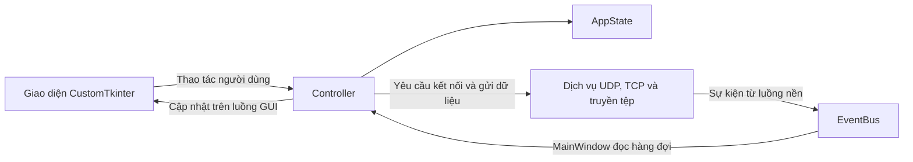

# Furina Chat

Furina Chat là ứng dụng desktop ngang hàng (P2P) để nhắn tin và chia sẻ tệp giữa các máy trong cùng mạng LAN. Mỗi máy chạy cùng một chương trình. UDP tìm người và cập nhật trạng thái, còn TCP truyền tin nhắn, sticker, ảnh và tệp.

## Cài đặt

Cần Python **3.10 trở lên**, Tkinter và mạng LAN IPv4 để thử giữa các máy. Kiểm tra Tkinter bằng `python -m tkinter`. Các phụ thuộc Python gồm CustomTkinter cho giao diện, Pillow cho ảnh và psutil để đọc thông tin adapter mạng.

Nếu chưa có mã nguồn, lấy repo bằng Git.

```powershell
git clone https://github.com/hieupham-uwu/furina-chat.git
cd furina-chat
```

Trên Windows, mở PowerShell tại thư mục chứa `main.py` và chạy lệnh cài đặt.

```powershell
python -m venv .venv
.\.venv\Scripts\python.exe -m pip install -r requirements.txt
```

Trên macOS hoặc Linux, dùng các lệnh sau. Nếu hệ điều hành đóng gói Tkinter riêng, cài gói đó cho bản Python đang dùng.

```bash
python3 -m venv .venv
./.venv/bin/python -m pip install -r requirements.txt
```

## Khởi chạy trên LAN

Chạy ứng dụng từ thư mục dự án trên từng máy trong cùng mạng Wi-Fi hoặc Ethernet. Đặt tên khác nhau để dễ nhận diện. Lệnh dưới đây dùng đường dẫn Python trên Windows. Trên macOS hoặc Linux, thay `.\.venv\Scripts\python.exe` bằng `./.venv/bin/python`.

```powershell
.\.venv\Scripts\python.exe main.py --name "Máy A"
```

| Tùy chọn | Công dụng |
| --- | --- |
| `--name "Máy A"` | Đặt tên hiển thị. Nếu bỏ qua, app dùng `FURINA_NAME`, tên tài khoản hoặc tên máy. |
| `--port 5001` | Chọn cổng TCP lắng nghe. Mặc định hệ điều hành cấp cổng trống và app quảng bá cổng đó trong `HELLO`. |
| `--discovery-ip 192.168.1.255` | Chọn địa chỉ đích gửi discovery. Ví dụ này dùng broadcast của mạng `192.168.1.0/24`. Dùng địa chỉ broadcast tương ứng với mạng thực tế của nhóm. |

## Sử dụng

- **Đang online** liệt kê người đang được phát hiện qua UDP, gồm cả người đặt trạng thái **Away**. Chọn một người để mở chat và xem IP, cổng TCP ở đầu khung chat.
- **Lịch sử** liệt kê các cuộc trò chuyện đã có tin hoặc tệp trong phiên đang chạy. Bạn vẫn xem được nội dung khi người kia Offline. Lịch sử và bản nháp được giữ trong bộ nhớ xuyên suốt phiên sử dụng.
- Nút trạng thái chuyển giữa **Online** và **Away**. Khi một người xuất hiện hoặc mất tín hiệu UDP, mục **Chats** hiện thông báo. Sau khoảng 10 giây thiếu `HELLO`, người đó được đánh dấu **Offline**.
- Nhấn **Enter** hoặc nút **Gửi** để gửi tin, tối đa **4.000 ký tự** mỗi tin. Tin từ cuộc chat khác được lưu và có số chưa đọc cạnh tên người gửi.
- Dùng các nút tệp, ảnh và sticker cạnh ô nhập. Từng tệp có thanh phần trăm riêng. Nút hủy xuất hiện khi lượt gửi còn có thể dừng. Tệp nhận nằm trong **`downloads/`** cạnh `main.py`.
- **Rời chat** đóng phiên TCP với người đang chọn bằng `BYE` và giữ nội dung cũ, bản nháp.
- **Thoát app** ở cuối thanh bên đóng toàn bộ ứng dụng, giống nút **X**. App dừng `HELLO` và gửi `BYE` cho các kết nối chat còn mở nếu đường truyền vẫn hoạt động.

## Kiến trúc

### Cây thư mục

```text
furina-chat/
├── main.py                 # Điểm khởi chạy GUI và các dịch vụ mạng
├── config.py               # Cổng, thời gian chờ và hằng số giao thức
├── requirements.txt        # Phụ thuộc Python
├── README.md
├── .gitignore
├── core/
│   ├── controller.py       # Điều phối thao tác và cập nhật giao diện
│   ├── event_bus.py        # Hàng đợi chuyển sự kiện giữa các luồng
│   ├── events.py           # Kiểu dữ liệu Event
│   └── state.py            # Peer, lịch sử, bản nháp và số tin chưa đọc
├── network/
│   ├── udp_service.py      # Tìm peer, quảng bá trạng thái và kiểm tra hết hạn
│   ├── tcp_service.py      # Bắt tay, quản lý kết nối và trao đổi tin chat
│   ├── file_service.py     # Gửi, nhận, hủy và cập nhật tiến độ truyền tệp
│   └── protocol.py         # Mã hóa gói UDP và đọc, ghi frame TCP
├── ui/
│   ├── main_window.py      # Bố trí cửa sổ và đọc sự kiện trên luồng GUI
│   ├── peer_sidebar.py     # Hai tab peer, thông báo và trạng thái cá nhân
│   ├── chat_panel.py       # Hội thoại, ô nhập và thanh tiến độ
│   ├── sticker_picker.py   # Bảng chọn sticker
│   └── avatar.py           # Tạo avatar từ ký tự đầu của tên
├── assets/
│   └── stickers/           # Ảnh sticker dùng trong giao diện
│       ├── columbina/
│       └── yanfei.jpg
├── tests/
│   ├── test_discovery.py   # Khám phá peer qua UDP
│   ├── test_protocol.py    # Định dạng frame và đọc đủ dữ liệu
│   ├── test_chat.py        # Kết nối TCP, tin nhắn, sticker và BYE
│   └── test_transfer.py    # Truyền đồng thời, hủy và dọn tệp nhận dở
├── docs/
│   └── architecture.md    # Sơ đồ và ghi chú thiết kế ban đầu
├── test_ui.py              # Script thử giao diện từ giai đoạn làm mẫu
└── downloads/              # Tự tạo khi nhận tệp, nằm ngoài Git
```

### Luồng xử lý



`main.py` khởi tạo trạng thái, hàng đợi sự kiện, cửa sổ chính và các dịch vụ mạng. Các luồng mạng đưa kết quả vào `EventBus`. `MainWindow` đọc hàng đợi bằng `after()` trên luồng GUI và chuyển từng sự kiện cho `Controller` cập nhật trạng thái và giao diện.

### Giao thức và cổng

| Luồng | Giao thức | Dữ liệu |
| --- | --- | --- |
| Khám phá và trạng thái | UDP **9999** | `HELLO` là JSON UTF-8 chứa ID, tên, cổng TCP và trạng thái. App phát broadcast mỗi **3 giây** và bỏ peer khỏi danh sách hiện diện sau khoảng **10 giây** thiếu `HELLO`. |
| Chat | Một kết nối TCP cho mỗi cặp peer đang chat | `HI` với `purpose="chat"` nhận diện peer. Kết nối mang `MSG`, `STICKER` và `BYE`. |
| Truyền tệp và ảnh | Kết nối TCP riêng cho mỗi lượt truyền | `HI` với `purpose="media"`, tiếp theo là `FILE` hoặc `IMAGE` và dữ liệu. Máy nhận ghi tệp tạm `.part`, đổi sang tên đích khi nhận đủ và xác nhận bằng `FILE_OK`. Khi lỗi, máy nhận báo `FILE_ERROR` nếu còn kết nối và dọn tệp tạm. |

Frame TCP gồm 6 byte nhận diện `Furina`, 4 byte độ dài header theo thứ tự byte mạng, header JSON UTF-8 và phần dữ liệu thô dành cho tệp hoặc ảnh. Cổng TCP mặc định do hệ điều hành cấp. Khi bắt Wireshark, dùng `udp.port == 9999` để xem discovery và **Follow → TCP Stream** trên kết nối chat để xem `HI`, `MSG` và `BYE`.

## Kiểm thử

Chạy bộ kiểm thử tự động từ thư mục dự án:

```powershell
.\.venv\Scripts\python.exe -m unittest discover -s tests -v
```

Bộ kiểm thử dùng kết nối cục bộ để kiểm tra discovery, khung giao thức TCP, tin nhắn Unicode, kết nối đồng thời, `BYE`, truyền file, hủy gửi và dọn tệp nhận dở.

Kiểm tra giao diện trên hai hoặc ba máy cùng LAN:

1. Mở app trên mỗi máy với tên khác nhau. Kiểm tra mọi máy thấy nhau ở **Đang online**. Đổi Online/Away ở một máy rồi quan sát phía còn lại.
2. Nhắn qua lại, sau đó để A chat với B và cho C gửi hai tin tới A. Kiểm tra A giữ nguyên ô đang gõ, thấy số chưa đọc của C và đọc được cả hai tin khi chuyển sang C.
3. Gửi file đủ lớn để quan sát phần trăm. Vừa gửi vừa nhắn tin, thử hủy một lượt khác và kiểm tra tệp đã nhận trong `downloads/`.
4. Nhấn **Rời chat** ở A. Kiểm tra B nhận thông báo rời chat, hai máy vẫn hiện trong **Đang online** và có thể mở lại tin cũ trong **Lịch sử**.
5. Nhấn **Thoát app** ở B. Trên A, đợi khoảng 10 giây để thấy thông báo Offline và B rời tab **Đang online**. Mở lại **Lịch sử** để kiểm tra nội dung cũ còn đọc được.

## Xử lý lỗi kết nối

- Nếu hai máy chưa thấy nhau, kiểm tra chúng có cùng mạng IPv4 và Wi-Fi cho phép các máy khách giao tiếp trực tiếp.
- Kiểm tra tường lửa có cho Python nhận UDP **9999** và kết nối TCP đến trên mạng riêng. Dùng `--port` nếu cần một cổng TCP lắng nghe cố định để thử.
- Nếu máy có nhiều adapter, dùng `--discovery-ip` với địa chỉ broadcast của LAN cần thử.
