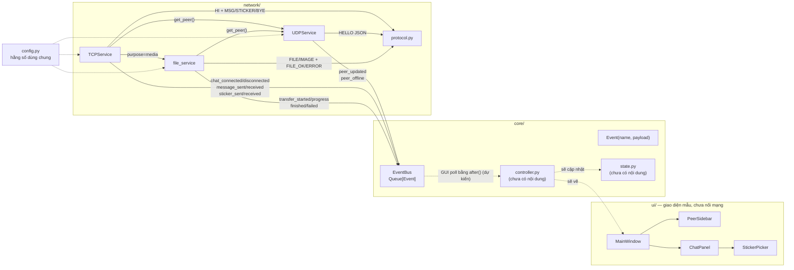
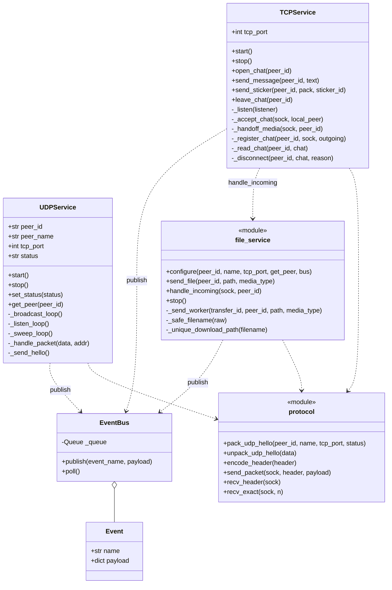
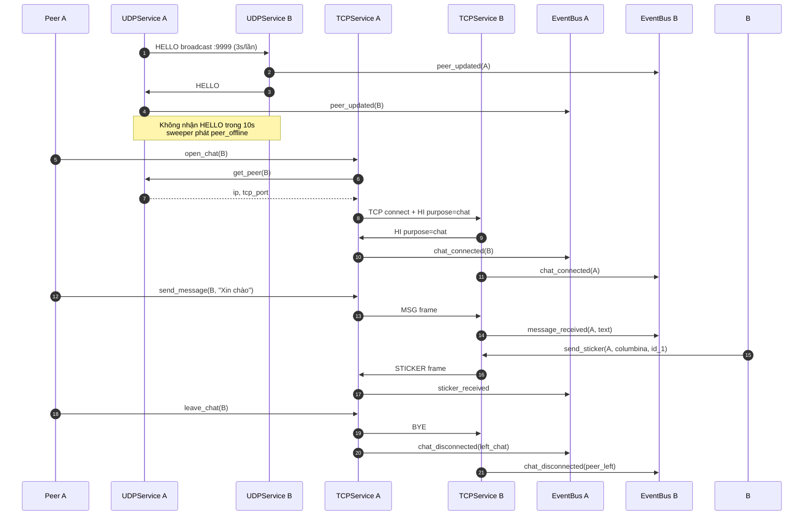
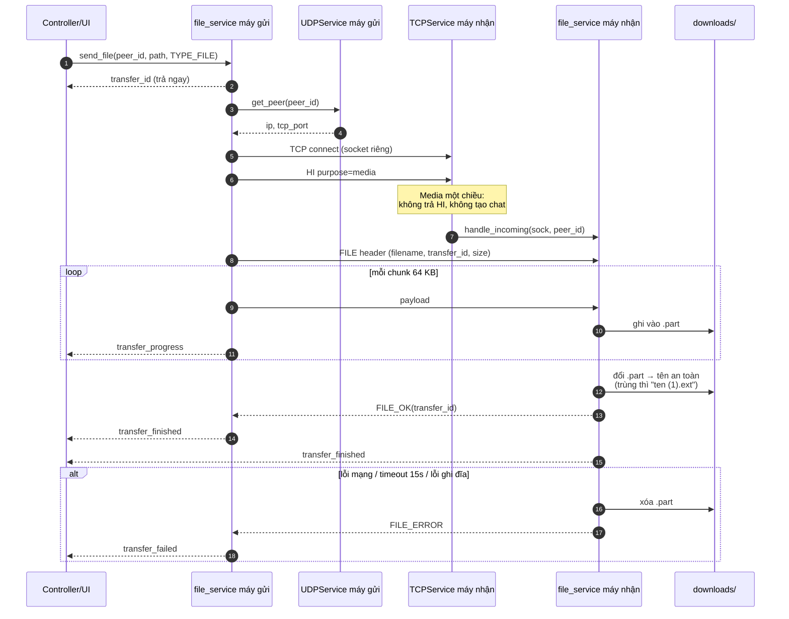

# Kiến trúc Furina Chat

Tài liệu mô tả cách dự án LAN chat hoạt động, các module, hàm công khai và luồng dữ liệu giữa hai máy. Các sơ đồ dùng Mermaid, xem được trong VS Code (tiện ích Markdown Preview Mermaid Support), GitHub hoặc [mermaid.live](https://mermaid.live).

## 1. Tổng quan

Furina Chat là ứng dụng chat trong mạng LAN, không cần server trung tâm:

- **Discovery (UDP)**: mỗi phiên gửi `HELLO` broadcast tới cổng `9999` mỗi 3 giây. Peer không gửi `HELLO` trong 10 giây bị coi là offline.
- **Chat (TCP)**: khi mở chat, hai máy bắt tay bằng frame `HI purpose="chat"`, sau đó trao đổi `MSG`, `STICKER`, `BYE`. Mỗi cặp peer giữ tối đa một kết nối chat.
- **Truyền file/ảnh (TCP)**: mỗi lượt gửi mở một kết nối TCP riêng với `HI purpose="media"`, truyền `FILE`/`IMAGE` theo chunk 64 KB, chờ `FILE_OK` rồi mới báo hoàn tất.
- **EventBus**: các dịch vụ mạng không gọi trực tiếp GUI mà đẩy sự kiện vào hàng đợi. GUI/controller đọc hàng đợi trên main thread.

Cổng TCP mặc định là `0` (hệ điều hành tự cấp), cổng thực tế được quảng bá trong `HELLO`, nhờ đó nhiều phiên chạy được trên cùng một máy.

## 2. Cấu trúc thư mục

```text
furina-chat/
├── main.py                  # Entry hiện tại: console test UDP + TCP
├── config.py                # Toàn bộ hằng số giao thức, timeout, sự kiện
├── core/
│   ├── events.py            # Event(name, payload)
│   ├── event_bus.py         # EventBus: publish()/poll() trên Queue
│   ├── models.py            # (chưa có)
│   ├── state.py             # (chưa có nội dung)
│   └── controller.py        # (chưa có nội dung)
├── network/
│   ├── protocol.py          # Framing TCP, pack/unpack HELLO, recv_exact
│   ├── udp_service.py       # Broadcaster, Listener, Sweeper
│   ├── tcp_service.py       # Chat 1-1, handshake, điều phối media
│   └── file_service.py      # Gửi/nhận FILE & IMAGE
├── ui/
│   ├── main_window.py       # Giao diện mẫu, còn giả lập sự kiện
│   ├── peer_sidebar.py
│   ├── chat_panel.py
│   └── sticker_picker.py
├── assets/stickers/<pack>/<sticker_id>.png
├── downloads/               # File nhận được (đã gitignore)
└── tests/
    ├── test_protocol.py
    ├── test_chat.py
    └── test_transfer.py
```

## 3. Kiến trúc tổng thể



## 4. Class và hàm chính



## 5. Luồng discovery và chat



## 6. Luồng truyền file/ảnh



## 7. Định dạng dữ liệu trên đường truyền

```text
TCP:  [ "Furina" 6B ][ header_len 4B big-endian ][ JSON UTF-8 ][ payload ... ]
UDP:  [ JSON UTF-8 ]  (một datagram, không có magic/framing)
```

- `MAGIC_BYTES = b"Furina"` giúp phát hiện gói rác ngay từ 6 byte đầu.
- `header_len` nằm trong khoảng `1..65536`; JSON sai schema, sai kiểu, `NaN` hoặc lồng quá sâu đều bị từ chối.
- Chỉ `FILE` và `IMAGE` được mang payload; các frame chat có `payload_size = 0`.
- HELLO UDP gồm `peer_id`, `name`, `tcp_port`, `status`; gói sai kiểu bị bỏ qua.

## 8. Bảng tra nhanh

| Việc muốn làm | Gọi hàm | Sự kiện phát ra |
| --- | --- | --- |
| Bật mạng | `tcp.start()` rồi `udp.start()` | `peer_updated`, `peer_offline` |
| Xem peer | `udp.get_peer(peer_id)` | — |
| Đổi online/away | `udp.set_status("away")` | Gửi HELLO ngay; máy khác nhận `peer_updated` |
| Mở chat | `tcp.open_chat(peer_id)` | `chat_connected` hoặc `operation_failed` |
| Gửi tin | `tcp.send_message(peer_id, text)` | `message_sent` (gửi), `message_received` (nhận) |
| Gửi sticker | `tcp.send_sticker(peer_id, pack, id)` | `sticker_sent` / `sticker_received` |
| Đóng chat | `tcp.leave_chat(peer_id)` | `chat_disconnected` |
| Gửi file/ảnh | `file_service.send_file(peer_id, path, TYPE_FILE/IMAGE)` | Trả `transfer_id`; `transfer_*` |
| Nhận file | Tự động qua TCP → `handle_incoming` | `transfer_started/progress/finished/failed` |
| GUI lấy sự kiện | `event_bus.poll()` trong `after(50)` | `Event(name, payload)` |

## 9. Mô hình luồng

- **UDP**: một socket, ba luồng nền — Broadcaster (3 giây), Listener, Sweeper (quét mỗi 1 giây, hết hạn sau 10 giây).
- **TCP**: một luồng `accept`; mỗi kết nối một worker. Chat có luồng đọc riêng, ghi được bảo vệ bằng `send_lock`. Kết nối media được bàn giao nguyên socket cho `file_service`.
- **File**: mỗi lượt gửi chạy trong một luồng nền; phía nhận chạy trên worker TCP, ghi `.part` rồi mới đổi tên.
- **GUI dự kiến**: chỉ đọc `EventBus` trên main thread bằng `after()`, không gọi socket trực tiếp.

## 10. Xử lý lỗi và timeout

| Tình huống | Cơ chế |
| --- | --- |
| Gói rác / header quá lớn | Kiểm tra magic, giới hạn 64 KB, đóng socket |
| HI đến chậm | Hạn chót 5 giây cho toàn bộ frame HI |
| Peer crash không gửi BYE | `recv()` trả `b""` hoặc `ConnectionResetError` → `chat_disconnected` |
| Peer vừa offline | `get_peer()` trả `None` → `operation_failed`, GUI báo lỗi |
| Mất mạng khi truyền file | Timeout 15 giây, xóa `.part`, gửi `FILE_ERROR`, phát `transfer_failed` |
| Gửi file trùng tên | Tự chọn `ten (1).ext`, `ten (2).ext`… |
| Tên file nguy hiểm | Bỏ đường dẫn/ký tự cấm, chặn tên thiết bị Windows (`CON`, `NUL`…) |
| Hai bên cùng mở chat | Giữ kết nối do peer có `peer_id` nhỏ hơn khởi tạo |

## 11. Hiện trạng tích hợp

- **Đã chạy thật**: UDP discovery, đổi trạng thái, chat 1-1, sticker, BYE, truyền file/ảnh qua kết nối media.
- **Đã có test**: 21 test (`test_protocol`, `test_chat`, `test_transfer`).
- **Chưa nối**: `core/state.py`, `core/controller.py`, `core/models.py` và GUI thật; `main.py` hiện vẫn là console test.
